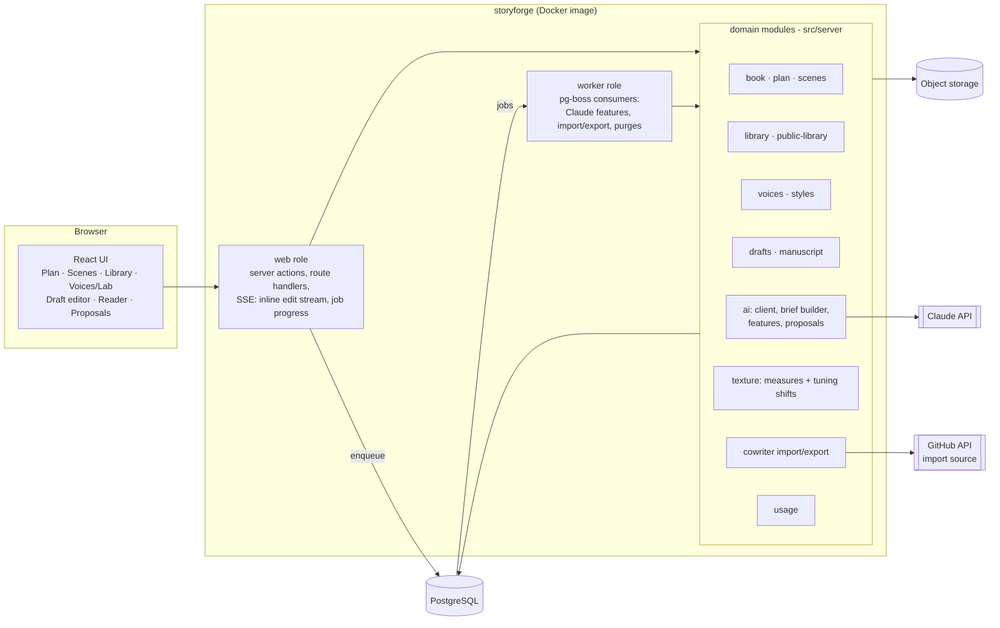
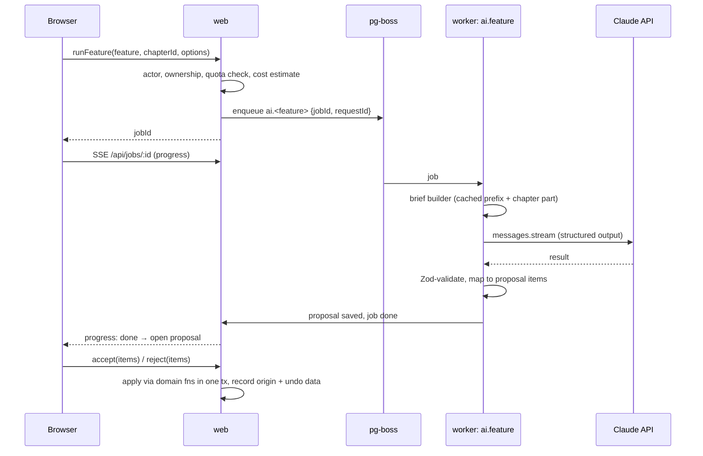

# storyforge — Architecture

Status: draft v2 for review · 2026-11-17 · companion to [PRD.md](PRD.md)

## 1. Constraints that shape the design

- storyforge is the successor to cowriter: its data model must hold everything a cowriter book folder holds, and import/export it without loss.
- The server is the single copy of a book. No client-side store that syncs later (the Manuscript Desk's failure mode).
- Claude features are long (drafting a chapter in two languages, chapter reviews) and must not change the book until the author accepts; they run as background jobs that produce **proposals**.
- Hosted, multi-user, private by default. One author per book in v1.
- One language end to end: TypeScript.

## 2. Stack

| Concern | Choice | Why |
|---|---|---|
| Language / runtime | TypeScript (strict), Node.js 22 LTS | One language for UI, server, worker, importer, texture measures |
| Web framework | Next.js 15 (App Router), React 19 | Server components, server actions, route handlers in one app |
| Rich text | TipTap 3 (ProseMirror; 3.32.3 pinned in E02, v2 is maintenance-only) | Concept, research notes, rules, character entries; paragraph editor uses a lighter TipTap instance per paragraph |
| Database | PostgreSQL 16 | Relational book model, JSONB for flexible sub-structures, full-text search, job queue |
| ORM / migrations | Drizzle ORM + drizzle-kit | Typed SQL, SQL migrations in the repo |
| Auth | Better Auth 1.7 (Drizzle adapter, magic-link plugin, Google provider) | Self-hosted sessions in Postgres; stable release line (Auth.js v5 was still beta in Nov 2026) |
| Validation | Zod at every boundary (inputs, Claude structured outputs, import parsers) | One schema for checks and types |
| Background jobs | pg-boss | Claude features, import/export, purges; retries; cancel |
| Object storage | S3-compatible (MinIO locally) | Research PDFs/images, public-library texts, import/export zips |
| Markdown | unified / remark (+ remark-gfm, footnotes) | Import of cowriter files, export back to them |
| Claude | `@anthropic-ai/sdk`, default `claude-opus-5-5` | See §7 |
| Logging | pino | Structured JSON, child loggers |
| Tests | Vitest, Playwright | Unit/integration, e2e |
| Packaging | Docker image, roles `web` and `worker` | Long-lived processes for streams and jobs |

## 3. Components



- Only `src/server/<module>` touches the database, storage, Claude or GitHub. Every exported domain function takes an `actor` and enforces ownership.
- **Proposals** are the hinge between Claude and the book: a Claude job writes a `proposal` with typed `proposal_item`s (e.g. "set paragraph 03.014 text (EN) from X to Y", "add scene card 3.4", "add continuity fact"); the author accepts or rejects items; accepting applies them through the normal domain functions in one transaction and records the origin.
- **Brief builder** (`ai/brief`): assembles the context a feature needs from book data, in a fixed order so the stable part is cacheable — the equivalent of the Desk's `context/book` and `context/ch-NN` documents and the skills' context packets.
- **Texture** (`texture`): pure TypeScript port of cowriter's `texture.py` measures, `TARGET_LABELS` and `TUNING_SHIFTS`, with golden tests against the Python outputs.

### Repository layout

```
src/
  app/                 routes: (book)/[bookId]/plan, scenes, library, voices, lab, draft, reader; admin/; api/
  components/          plan/, scenes/, library/, voices/, draft/, reader/, proposals/
  server/
    auth/  book/  plan/  scenes/  library/  public-library/  voices/  styles/
    drafts/  manuscript/  ai/{client,brief,features,proposals}/  texture/
    cowriter/{import,export,parsers}/  usage/  jobs/  db/  log.ts
  shared/              framework.ts (tags + 31 dimensions, groups A–G), id-scheme.ts, readiness.ts
  worker.ts
tests/  unit/ integration/ e2e/ fixtures/{claude,cowriter-book,texture}/
```

## 4. Key request paths

### Claude feature as a job → proposal → accept



Features and their outputs:

| Feature | Output (proposal items) | Mode |
|---|---|---|
| readiness | readiness line + per-parameter reasons | job |
| scene-builder | scene cards (add/replace), plan changes, open questions | job (brainstorm = multi-step job with author answers between steps) |
| drafting | draft first text: paragraphs per language with ids, scene markers, footnotes | job |
| inline-edit | replacement text for a selection | streamed SSE, no job |
| apply-tuning | paragraph rewrites per language with "what changed / what to check" | job, item per paragraph, streamed into the proposal as each lands |
| sense-and-flow | fixes (move, merge, cut, bridge, rewrite) | job |
| prose-review | report + paragraph suggestions + continuity facts | job (chapter pass + paragraph passes) |
| voice-lab-test / voice-rules | test paragraphs / drafted rules | job |

Inline edit and voice-lab tests write directly to their own records (suggestion view, lab tests) rather than the book, so they skip the proposal table.

### Autosave of a paragraph

Client keeps a per-paragraph pending queue; `saveParagraph(id, lang, text, baseVersion)` → domain checks `version = baseVersion` → update + `version+1` + history row (coalesced to one per 10 min per paragraph unless manual) → ack. Conflict → 409 with server text; the UI shows both. Pending edits survive reload via `sessionStorage` until acked.

## 5. Data model (sketch)

```
user(id, email, name, role, monthly_token_cap?)

book(id, owner_id, slug, title, one_liner, length_target, length_limit, id_scheme jsonb,
     truth_labels text[], profile_notes jsonb, created_at)
book_language(book_id, code, name, written_first bool, position)
standing_rule(id, book_id, number, body jsonb, decided_on date)
concept(book_id, body jsonb)
part(id, book_id, title jsonb /*per lang*/, position)
chapter(id, book_id, part_id, code /*'01','00','99','INT'*/, title jsonb, position, when_where, 
        readiness jsonb /*score, params, date, by*/)

plan_item(id, chapter_id, kind[event|fact|note|source], number, text jsonb, truth_label?, to_verify bool,
          source_refs uuid[], research_doc_id?, position, removed_at?, updated_by, updated_at)
scene_card(id, chapter_id, number, title, covers jsonb, when, where, scenario_spot_id?, pov,
           characters jsonb, shape jsonb /*19,20,27-30 + things*/, slow_down, reader_feeling,
           texture_note, note, position)

research_folder(id, book_id, path) ; research_doc(id, book_id, folder_id, title, kind[md|pdf|image],
           body jsonb?, file_key?, truth_label?)
character(id, book_id, name, names_by_stage jsonb, group?, bullets jsonb, speech_voice_id?, position)
continuity_fact(id, book_id, category, text, paragraph_refs text[], character_id?, created_from?)
scenario(id, book_id, place, period, body jsonb) ; scenario_spot(id, scenario_id, key, text)
colour_script(book_id, body jsonb)
lexicon_entry(id, book_id, key, terms jsonb /*lang->term*/, notes jsonb /*lang->note*/)

voice(id, book_id, code /*NARR-MAIN*/, name, type, tags jsonb, status)
voice_version(id, voice_id, version, dims jsonb /*1..31: base,min,max,note*/, rules jsonb,
              texture jsonb, layers jsonb /*lang->layer*/, change_note, created_at)
author_library_entry(id, book_id, public_author_id?, name, scores jsonb, portrait, fit_notes)
chapter_style(chapter_id, voice_in_use_id)
chapter_voice_setting(chapter_id, voice_id, tuning jsonb, reason, status, texture_overrides jsonb)
voice_lab_test(id, book_id, voice_id, profile jsonb, chapter_id?, langs, paragraphs jsonb, note, created_at)

draft(id, chapter_id, voice_id)                                 -- one per chapter per narrator voice
draft_version(id, draft_id, kind[first|revised])
paragraph(id, book_id, chapter_id, container_id /*draft_version or manuscript*/, pid /*'03.014a'*/,
          order_key, scene_marker?, own_voice_id?, voice_version?, applied_tuning jsonb?,
          review_status, open_issues, removed_at?)
paragraph_text(paragraph_id, lang, text, version int, updated_at, updated_by)
paragraph_history(id, paragraph_id, lang, text, version, reason[auto|manual|ai:<feature>|restore|promote], at)
scene_review(chapter_id, voice_id, scene_name, at)

public_author(id, name, slug, notes) ; public_book(id, author_id, title, year, language, translator,
          source, pd_status, text_key?) ; style_study(author_id, body jsonb, scores jsonb)
texture_profile(author_id, measures jsonb, sample_note)

proposal(id, book_id, feature, chapter_id?, status, summary, created_by_job, created_at)
proposal_item(id, proposal_id, kind, target jsonb, before jsonb, after jsonb, note, state[open|accepted|rejected], applied_at?)
job_run(id, kind, book_id, status, progress jsonb, error?, request_id, created_at)
ai_usage(id, user_id, book_id, feature, model, effort, input_tokens, output_tokens, cache_read, cache_write,
         cost_usd, anthropic_request_id, stop_reason, created_at)
import_run(id, book_id, source jsonb, dry_run bool, report jsonb, created_at)
```

- The 31-dimension framework (tags, groups A–G, pole labels, language-sensitive dimensions 4/5/6/7/11, scene-level dimensions 19/20/27–30) lives in `src/shared/framework.ts`, not in the database.
- Paragraph text is one row per language so concurrency, history and "whose wording leads" stay per language.
- The manuscript is a container like a draft version (`container_id` → manuscript row per book); promote copies paragraphs with their ids.

## 6. Security

- Ownership enforced in every domain function; integration tests assert cross-user denial for every entity type.
- Admin-only: public library writes, caps, usage pages (`requireAdmin()`).
- Server actions CSRF-protected; route handlers check session and `Origin`; rate limits on auth and Claude endpoints.
- Prompt injection: book text, research and public-library text are placed in delimited sections; system prompts state they are material to work on, not instructions; structured outputs are validated before becoming proposals; nothing Claude returns is executed.
- Import: zip extraction with size/entry limits and path normalisation (no traversal); GitHub import uses the user's token only for that request, never stored; Markdown parsed, never rendered as raw HTML.
- Secrets only in env. Secure-coding rule packs: owasp-2025, typescript, react, docker, github-actions, ai-security (`.claude/rules/security/`).

## 7. Claude integration

- **Client**: one `Anthropic` client in `ai/client.ts`; every call goes through `ai.call()` (logging, metering, error mapping, refusal handling, fallbacks, cancellation).
- **Model**: `claude-opus-5-5` for every feature; per-feature env overrides (`AI_<FEATURE>_MODEL`, `AI_<FEATURE>_EFFORT`).
- **Effort**: inline edit `low`; readiness `medium`; scene builder, drafting, apply-tuning, reviews `high`; voice lab `medium`.
- **Streaming**: all calls use `messages.stream()`; inline edit forwards deltas over SSE; jobs use `finalMessage()` and report progress per step.
- **Structured outputs**: every job feature uses `output_config.format` with a JSON schema mirroring its proposal items; validated again with Zod.
- **Brief builder & caching**: prompts are ordered tools → system (feature instructions, versioned in `ai/features/<name>/prompt.md`, each naming the cowriter skill section it implements) → book brief (profile, standing rules, concept handle-with-care, lexicon, shared rules, continuity) → voice brief (rules, layers, chapter tuning) → chapter material. Cache breakpoints after the book brief and after the voice brief, so repeated runs on one book reuse them; `cache_read_input_tokens` is logged.
- **Refusals & fallbacks**: check `stop_reason` before reading content; server-side fallbacks enabled (`fallbacks: "default"` with beta `server-side-fallback-2026-07-01`); a refusal ends the job with a clear message and is not charged against the cap.
- **Errors**: typed SDK errors mapped to user messages (busy/retry vs bug); SDK retries left at 2; job-level retry only for transient errors.
- **Testing**: `FakeClaude` replays fixtures from `tests/fixtures/claude/<feature>/`; real calls only in `npm run eval:<feature>`.

## 8. Logging & observability convention

- pino; `log(name)` → child logger; names `storyforge:<module>[:<sub>]` (e.g. `storyforge:drafts:autosave`, `storyforge:ai:drafting`, `storyforge:cowriter:import`).
- `requestId` from AsyncLocalStorage on every line (incoming `x-request-id` reused); jobs log `jobId` and the originating `requestId`.
- Boundary events: `request` (route, status, ms, userId); `ai.call.start|end` (feature, model, effort, tokens, cache tokens, ms, stop_reason, anthropic_request_id); `job.start|progress|end|fail`; `proposal.created|accepted|rejected` (counts); `autosave.conflict`; `quota.refused`; `import.report` (counts, warnings).
- `LOG_LEVEL` env (default `info`, `debug` locally); stdout (JSON in prod, pretty in dev) and `logs/app.log` locally.
- Never log book text, research or library text; ids, sizes and counts only.
- `GET /api/health` → `{ version, db }`.

## 9. Test strategy

| Layer | Tool | Scope | In CI |
|---|---|---|---|
| Unit | Vitest | framework, id scheme, readiness maths, tuning ranges, texture measures (golden vs `texture.py`), brief assembly, parsers, diff | yes |
| Integration | Vitest + Postgres | domain modules, ownership, proposals apply/undo, import/export round trip on fixture book, FakeClaude | yes |
| E2E | Playwright vs `next build` + worker | core flows (see PRD §13) with FakeClaude | yes |
| Interactive dev checks | Playwright MCP / Claude in Chrome | exploratory UI checks per epic | no |
| Claude evals | `npm run eval:<feature>` | quality on fixed samples from the real book | no (manual, costs money) |

Fixture book: a reduced copy of a cowriter book (2 chapters, both languages, voices, plan, cards, research) committed under `tests/fixtures/cowriter-book/`, with personal content replaced where needed.

## 10. Environments

| | Local | CI | Staging / prod |
|---|---|---|---|
| App | `npm run dev` + `npm run worker` | built image | Docker image, `web` + `worker` |
| Postgres | docker compose | service container | managed, PITR |
| Storage | MinIO | MinIO | S3-compatible bucket |
| Claude | FakeClaude; real key opt-in | FakeClaude | real key from secret store |
| Auth | email to console or an outbox folder (`EMAIL_TRANSPORT`) | outbox folder, read by e2e | SMTP email + Google |

Migrations: `drizzle-kit migrate` as a release step.
