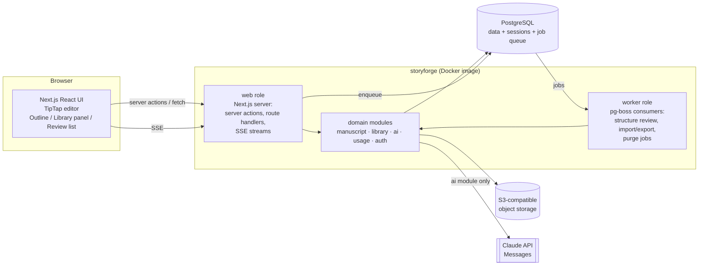

# storyforge — Architecture

Status: draft for review · 2026-11-17 · companion to [PRD.md](PRD.md)

## 1. Constraints that shape the design

- Hosted, multi-user web app; manuscripts are private by default and must never leak across users.
- Long documents (a book is 80–200k words) and long Claude calls (a chapter review can take a minute or more), so the server must stream and run background jobs, not just short serverless requests.
- One small team, one language: TypeScript end to end.

## 2. Stack

| Concern | Choice | Why |
|---------|--------|-----|
| Language | TypeScript (strict), Node.js 22 LTS | One language for UI, server, worker |
| Web framework | Next.js 15 (App Router), React 19 | Server components + server actions + route handlers in one app |
| Editor | TipTap 2 (ProseMirror) | Mature rich-text model, custom nodes (scene break, author note, entry mention), JSON document storage |
| Database | PostgreSQL 16 | Relational ownership model, full-text search (`tsvector`), JSONB for documents, job queue |
| ORM / migrations | Drizzle ORM + drizzle-kit | Typed SQL, plain SQL migrations in the repo |
| Auth | Auth.js (NextAuth v5) with Drizzle adapter; email magic link + Google | Standard, self-hosted sessions in Postgres |
| Validation | Zod at every server boundary | One schema for input validation and types |
| Background jobs | pg-boss on the same Postgres | No extra infrastructure; retries, scheduling |
| Object storage | S3-compatible (MinIO locally) | Library cover images, import/export files |
| Claude | `@anthropic-ai/sdk`, model `claude-opus-5-5` | See §7 |
| Logging | pino (+ pino-pretty in dev) | Structured JSON, fast, child loggers |
| Tests | Vitest, Playwright | Unit/integration and browser e2e |
| Packaging | Docker image, two roles: `web` and `worker` | Long-lived processes for streaming and jobs |

## 3. Components



- **web**: renders UI, handles server actions (CRUD, autosave), streams inline-edit suggestions over SSE, enqueues jobs, serves job status.
- **worker**: runs pg-boss jobs — chapter structure review, import/export, account purge, soft-delete purge.
- **domain modules** (`src/server/<module>`): the only code that touches the database or Claude. Every exported function takes an `actor` (the signed-in user) and enforces ownership itself; UI and handlers never query tables directly.

### Repository layout

```
src/
  app/                 Next.js routes (UI pages, route handlers under app/api)
  components/          React components (editor/, outline/, library/, review/)
  server/
    auth/              Auth.js config, getActor()
    manuscript/        projects, chapters, scenes, snapshots
    library/           libraries, entries, attachments, publishing, reports
    ai/                Claude client, prompts, inline-edit, structure-review
    usage/             metering, quotas
    jobs/              pg-boss setup and job handlers
    db/                drizzle schema, client, migrations
    log.ts             logger factory
  worker.ts            worker entrypoint
tests/
  unit/  integration/  e2e/  fixtures/claude/
```

## 4. Key request paths

### Inline edit (streamed)

```mermaid
sequenceDiagram
  participant B as Browser (editor)
  participant W as web: /api/ai/inline-edit (SSE)
  participant U as usage
  participant A as ai.inlineEdit
  participant C as Claude API
  B->>W: POST {sceneId, selection range, action, instruction?}
  W->>W: getActor(), Zod validate, ownership(sceneId)
  W->>U: checkQuota(actor)
  U-->>W: ok / refused
  W->>A: build prompt (style sheet, surrounding text, selection)
  A->>C: messages.stream (claude-opus-5-5, effort low)
  C-->>A: text deltas
  A-->>W: deltas
  W-->>B: SSE events (delta…, done{usage})
  A->>U: record(ai_usage)
  B->>B: show word diff; Accept → replace selection (one undo step) → autosave
```

### Structure review (background)

1. Browser calls server action `requestReview(chapterId)` → ownership + quota check → insert `review(status=queued, manuscript_version)` → enqueue `review.chapter` job.
2. Worker builds the prompt: stable prefix (system prompt, style sheet, referenced library entries, summaries of earlier chapters — cached), then the chapter's scenes with scene ids.
3. Claude returns findings as structured output (JSON schema, see §7); worker validates with Zod, anchors each quote to a scene offset, stores `review_finding` rows, marks review `done` (or `failed` with reason).
4. Browser polls `/api/reviews/:id` (or SSE) for status and renders findings.

## 5. Data model (sketch)

```
user(id, email, name, role[user|admin], monthly_token_cap?, created_at)
project(id, owner_id→user, title, word_target?, style_sheet jsonb, deleted_at?)
chapter(id, project_id, title, position, deleted_at?)
scene(id, chapter_id, title, position, doc jsonb, text, word_count, version int, updated_at, deleted_at?)
scene_snapshot(id, scene_id, doc jsonb, word_count, reason[auto|manual|ai_accept|restore], created_at)
library(id, owner_id, title, description, visibility[private|public], licence?, cover_key?, hidden_at?, published_at?)
library_entry(id, library_id, type, title, aliases text[], body jsonb, text, tags text[], fields jsonb, search tsvector)
project_library(project_id, library_id, attached_at)       -- live attachment
library_report(id, library_id, reporter_id, reason, created_at, resolved_at?)
review(id, chapter_id, requested_by, status[queued|running|done|failed], manuscript_version jsonb, model, error?, created_at)
review_finding(id, review_id, scene_id, category, severity, quote?, anchor jsonb?, explanation, suggestion, state[open|resolved|dismissed])
ai_usage(id, user_id, feature, model, input_tokens, output_tokens, cache_read_tokens, cache_write_tokens, cost_usd, anthropic_request_id, created_at)
```

- Ordering uses integer `position` with renumbering in one transaction on reorder.
- `scene.version` increments on every save; saves send the version they were based on (optimistic concurrency, FR-7).
- `text` columns are derived plain text (author notes stripped) used for counts, search and prompts.
- Read access to a public library is a single query rule: `visibility = 'public' AND hidden_at IS NULL` or owner.

## 6. Security

- Every domain function receives `actor` and checks ownership or public visibility; integration tests assert cross-user access is denied for every entity.
- Server actions are CSRF-protected by Next.js; route handlers check the session and `Origin`.
- Rate limits (per user, in Postgres) on auth emails and Claude endpoints.
- User text placed in prompts is wrapped in clearly delimited sections and the system prompt tells Claude that manuscript and library content is material to work on, not instructions (public libraries are untrusted input from other users).
- Secrets only in env; `.env.example` lists names, never values.
- Secure-coding rule packs to install at ps-spec init (exact list confirmed then): core, typescript, react, docker, github-actions, ai-security.

## 7. Claude integration

- **Client**: one `Anthropic` client in `src/server/ai/client.ts`; all calls go through `ai.call()` which adds logging, usage metering, error mapping and fallbacks.
- **Model**: `claude-opus-5-5` for both features, configured per feature via env (`AI_INLINE_MODEL`, `AI_REVIEW_MODEL`, `AI_*_EFFORT`) so the operator can switch, e.g. to `claude-sonnet-5-5`, without code changes.
- **Thinking / effort**: adaptive thinking (the model's default); inline edit at `effort: "low"` for fast first tokens, review at `effort: "high"`.
- **Streaming**: inline edit uses `messages.stream()` and forwards text deltas over SSE; reviews use `messages.stream()` + `finalMessage()` in the worker to avoid HTTP timeouts on long outputs.
- **Structured output**: reviews use `output_config.format` with a JSON schema for the findings list, validated again with Zod.
- **Prompt caching**: the review prompt puts stable content first (system prompt → style sheet → library entries → earlier-chapter summaries) with a cache breakpoint before the chapter text, so re-running reviews on the same book reuses the prefix. `usage.cache_read_input_tokens` is logged to verify hits.
- **Refusals & fallbacks**: check `stop_reason` before reading content; server-side fallbacks enabled (`fallbacks: "default"`, beta `server-side-fallback-2026-07-01`); a `refusal` is shown as a clear message and is not charged against the user's cap.
- **Errors**: typed SDK errors mapped to user messages: rate limit/overload → "busy, retry", 4xx → logged as bugs. SDK retries (2) left on.
- **Testing**: a `FakeClaude` replays recorded fixtures from `tests/fixtures/claude/` in unit, integration and e2e tests; real calls only in the manual eval script.

## 8. Logging & observability convention

- Library: pino. Logger factory `log(name)` returns `pino.child({ module: name })`; names are `storyforge:<module>[:<sub>]`, e.g. `storyforge:manuscript:autosave`, `storyforge:ai:review`.
- Correlation: middleware assigns `requestId` (incoming `x-request-id` or a new UUID), stored in AsyncLocalStorage and added to every log line; jobs carry `jobId` and the originating `requestId`.
- Boundary lines: one `request` line per HTTP request (route, status, ms, userId); `ai.call` start/end (feature, model, effort, tokens, cache tokens, ms, stop_reason, anthropic request id); `job` start/end/fail; `autosave.conflict`; `quota.refused`.
- Levels: `LOG_LEVEL` env (default `info`, `debug` locally). Destinations: stdout (JSON in prod, pretty in dev) and `logs/app.log` locally.
- Privacy: never log manuscript or library text at any level; log ids, sizes and counts.
- Health: `GET /api/health` → `{ version, db: "ok" | "error" }`.

## 9. Test strategy

| Layer | Tool | Scope | In CI |
|-------|------|-------|-------|
| Unit | Vitest | pure domain logic, prompt assembly, diffing, anchoring | yes |
| Integration | Vitest + Postgres (compose service / CI service container) | domain modules and handlers incl. ownership checks, FakeClaude | yes |
| E2E | Playwright against `next build` + worker | core user flows, test auth provider, FakeClaude | yes |
| Interactive dev checks | Playwright MCP / Claude in Chrome | exploratory UI checks during epics | no |
| Claude evals | script `npm run eval:<feature>` | prompt/model quality on a fixed sample | no (manual, costs money) |

Commands: `npm test` (unit + integration), `npm run test:e2e`, `npm run lint`, `npm run typecheck`.

## 10. Environments

| | Local | CI | Staging / prod |
|-|-------|----|----------------|
| App | `npm run dev` + `npm run worker` | built image | Docker image, `web` + `worker` processes |
| Postgres | docker compose | service container | managed Postgres with PITR |
| Storage | MinIO (compose) | MinIO | S3-compatible bucket |
| Claude | FakeClaude by default; real key opt-in via `.env.local` | FakeClaude | real key from secret store |
| Auth | email via console transport + test provider | test provider | email provider + Google OAuth |

Migrations: `drizzle-kit migrate` as a release step before the new web/worker start.
