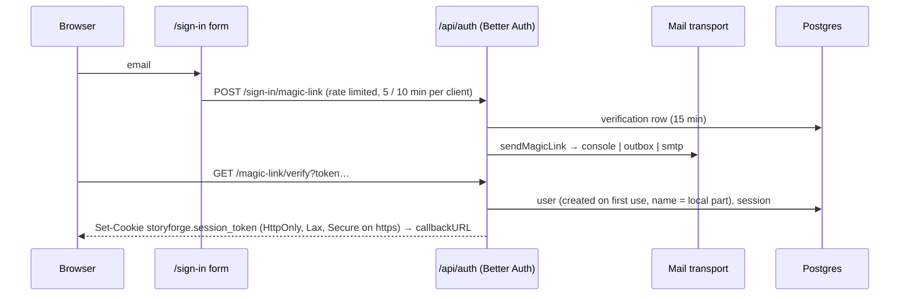

# Accounts & auth

## What it does

Authors sign in with an emailed magic link or Google (Better Auth 1.7.26, sessions in Postgres), set a display name, and can delete their account, which queues a purge of everything storyforge holds for them. Every server function gets the signed-in `actor` from `getActor()` and refuses other users' data with `requireOwner()` / `requireAdmin()` — **the access pattern every later epic follows**. Stories: E01/US-1 to US-3.

## How it works

**Better Auth** is configured once in `src/server/auth/auth.ts` (`authOptions(env)`, process singleton `getAuth()`): Drizzle adapter over the app pool, magic-link plugin (15 min, single use), optional Google, account linking trusted for Google, sessions 30 days sliding (refreshed daily), `freshAge` 1 day, rate limits stored in Postgres, cookies prefixed `storyforge.`, telemetry off. Its HTTP endpoints are mounted at `/api/auth/*` (`src/app/api/auth/[...all]/route.ts`) through `handleAuthRequest()`, which also logs what Better Auth doesn't: `auth.rate_limited` (429s) and `auth.link.invalid` (verify redirects with `error=`). Its own `/delete-user` routes are **disabled** — deletion only happens through our confirmed server action.



**Page protection, two layers:**
1. `src/middleware.ts` (edge): no session cookie → redirect to `signInPath(next)`; with a cookie it passes the requested path on in `x-storyforge-path`.
2. `(app)` server components call `requirePageActor()` (`src/server/auth/page-actor.ts`): one cached `getSession` per request; no valid session → redirect to sign-in with `next` (stale cookie case). `next` is always cleaned by `safeNext()` (local paths only).

**Access layer for every epic** (`src/server/auth/actor.ts`):
```ts
const actor = await getActor(undefined, "books.create");   // Unauthenticated → 401 / sign-in
requireOwner(actor, book.ownerId, "books.update");          // Forbidden → 404 (never 403)
requireAdmin(actor, "library.publish");                      // Forbidden → 404
```
Domain functions take `actor` first (see `updateDisplayName`). Route handlers can wrap with `withActorResponse()` (401/404 mapping; first used in E02). Copy `tests/integration/access.test.ts` (no session / another user's data / non-admin) for every new entity, using `twoUsers()` from `tests/integration/auth-helpers.ts`.

**Admin role:** `ADMIN_EMAILS` (case-insensitive) is applied on every sign-in by a `session.create.after` hook (`auth.role.synced` when it changes).

**Account deletion:** settings dialog → `deleteAccountAction` → `deleteAccount()` checks the typed `DELETE`, then `auth.api.deleteUser`. Better Auth refuses sessions older than 24 h (`SESSION_EXPIRED` → "stale-session" message). `beforeDelete` queues `account.purge` with a 60 s delay — if the queue is down, nothing is deleted; `afterDelete` removes unused sign-in links (keyed by email). The worker runs `runPurge(userId)`: skips if the account still exists, otherwise runs every step registered with `registerPurgeStep(name, fn)` in order (idempotent; failures retry via pg-boss, 5× with backoff).

**Client address for rate limits:** the request boundary (`src/server/http.ts`) overwrites `x-storyforge-client-ip` on every request — the socket address, or with `TRUST_PROXY_HOPS=N` the N-th X-Forwarded-For entry from the right. Better Auth reads only that header, so clients can't pick their bucket.

**Email:** `src/server/auth/mail.ts` — `console` (dev: banner on stdout, never via the logger), `outbox` (JSON files, tests), `smtp` (nodemailer; required in production). Production env validation refuses the other two.

## Files

| Path | Role |
|------|------|
| `src/server/auth/auth.ts` | Better Auth options/singleton, hooks (name default, role sync, purge queue), `handleAuthRequest`, `trustedOrigins`, `googleEnabled` |
| `src/server/auth/actor.ts` | `Actor`, `getActor`, `getOptionalActor`, `requireOwner`, `requireAdmin`, `Unauthenticated`, `Forbidden`, `withActorResponse` |
| `src/server/auth/page-actor.ts` | `currentActor` (cached per request), `requirePageActor` |
| `src/server/auth/mail.ts`, `hash.ts` | Mail transports + magic-link message; HMAC `emailHash` for logs |
| `src/server/account/account.ts` | `updateDisplayName`, `deleteAccount` |
| `src/server/jobs/{queue,purge,names}.ts` | Send-only pg-boss client, purge registry/runner, queue names |
| `src/server/db/schema/auth.ts`, `migrations/0001_auth.sql` | `user` (+ `role`, `monthly_token_cap`), `session`, `account`, `verification`, `rate_limit` |
| `src/middleware.ts`, `src/shared/{auth,headers,safe-next}.ts` | Edge redirect, shared constants (`AUTH_COOKIE_PREFIX`, `signInPath`, TTL note), `safeNext` |
| `src/app/(auth)/sign-in/…`, `src/app/(app)/…`, `src/app/goodbye` | Pages, settings forms, server actions |
| `src/client/auth-client.ts` | Browser Better Auth client (magic link, Google) |
| `tests/integration/auth-helpers.ts` | `signIn`, `twoUsers`, `requestLink`, `call`, outbox readers, `resetAuthTables` |
| `tests/e2e/smtp-sink.ts` | Local SMTP server for e2e (production refuses the outbox) |

## Configuration

| Variable | Default | Notes |
|----------|---------|-------|
| `BETTER_AUTH_SECRET` | — (required, ≥ 32 chars) | Signs cookies/tokens; keys `emailHash`. `openssl rand -base64 32`. Never logged |
| `BETTER_AUTH_URL` | `http://localhost:$PORT` (dev) | Public base URL; required in production; links and OAuth callbacks are built from it |
| `ADMIN_EMAILS` | empty | Comma-separated; synced at each sign-in |
| `TRUST_PROXY_HOPS` | `0` | Proxies in front of the app; set it when deploying behind one, or all users share one rate-limit bucket |
| `GOOGLE_CLIENT_ID` / `GOOGLE_CLIENT_SECRET` | empty | Both or neither. Redirect URI: `<BETTER_AUTH_URL>/api/auth/callback/google` |
| `EMAIL_TRANSPORT` | `console` | `console` \| `outbox` \| `smtp`; production must be `smtp` |
| `MAIL_OUTBOX_DIR` | `logs/outbox` | For `outbox` |
| `SMTP_URL` / `MAIL_FROM` | — / `storyforge <no-reply@localhost>` | For `smtp` (`smtp://` or `smtps://`) |

All roles share one environment: the web server, the worker and `node dist/migrate.js` all validate these settings at startup (production requires `BETTER_AUTH_SECRET`, `BETTER_AUTH_URL`, `EMAIL_TRANSPORT=smtp` and `SMTP_URL`), so give every container the same env.

## Logs & debugging

- **Happy path:** `auth.magic_link.requested` (`emailHash`, transport) → `mail.sent` → `auth.user.created` (first time) → `auth.sign_in` (`userId`, `method`) → … → `auth.sign_out`.
- **Trouble:**
  - `auth.link.invalid` (`invalid` / `expired`): a link that was already used or has expired.
  - `auth.rate_limited` (`path`, `retryAfterS`): a client hit the sign-in limit. If everyone hits it, check `TRUST_PROXY_HOPS`.
  - `mail.failed` (`transport`, `err`): links can't be delivered.
  - `access.denied` (`reason`: `unauthenticated` \| `not-owner` \| `not-admin`, `op`): access refused.
  - `account.delete.refused` (`confirmation` \| `stale-session`): deletion refused.
  - `account.purge.skipped`: the account still exists (the deletion failed after queueing).
  - `account.purge.step` with `ok: false`: a purge step failed; pg-boss retries it.
  - `better_auth`: Better Auth's own messages, with the request id.
- **Never logged:** email addresses, sign-in links or tokens, session tokens, `BETTER_AUTH_SECRET`. `tests/integration/log-hygiene.test.ts` guards this.
- **Dev sign-in:** `npm run dev`, enter any address, copy the link from the terminal banner (console transport). Or set `EMAIL_TRANSPORT=outbox` and read `logs/outbox/*.json`.
- **Is a session valid?** Query `curl -b <cookie> localhost:3000/api/auth/get-session`.
- **Tools:**
  - `http` (curl with `Origin` and `content-type: application/json` for POSTs).
  - `console` for the worker.
  - `playwright` for flows; recipes in `openspec/changes/archive/2026-11-19-e01-auth/test-plan.md`.

## How to run & test

- Run: `npm run dev` + `npm run worker` (Postgres up, migrations applied: `npm run db:migrate`).
- Tests: `npm test` (unit + integration against `storyforge_test`, emails to a temp outbox); `npm run build && npm run test:e2e` (production build, real SMTP to a local sink).
- Interactive cases T1–T11 in the test plan; T10 (real Google) needs your Google OAuth credentials.

## Known gaps / follow-ups

- **Purge steps:** E01 registers none; E02 registers `books` (`src/server/books/purge.ts`, wired in `src/worker.ts`). Every epic that stores user data must call `registerPurgeStep()` (and test it).
- **Orphan sweep:** a periodic sweep for data whose owner no longer exists is the safety net if a purge job ever exhausts its retries. Still not built: E02's book tables cascade from `user`, so they can't be orphaned; add the sweep with the first stored files (E03).
- **`withActorResponse`:** has no route handler yet; E02's first API route uses it.
- **Real Google sign-in (T10):** not exercised. Needs credentials; the config is tested.
- **Later optimisations:** a single-statement role sync, pg-boss sharing the app pool, SMTP connection pooling, and one registry to reset all process singletons in tests and at shutdown.
- **Production email provider:** not chosen yet. Any SMTP service works.

## References

- Behavior contract: `openspec/specs/auth-session/spec.md`, `openspec/specs/account-management/spec.md`
- Change: `openspec/changes/archive/2026-11-19-e01-auth/`
- PRD: FR-1–3, NFR-4, NFR-5; ARCHITECTURE.md §2 (Auth), §6 (Security)
