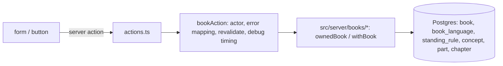

# Book profile & structure

## What it does

Authors create books from the home page and edit each book's profile: title, one-liner, word target and hard limit, people notes, languages (one written-first), standing rules (formatted, numbered, dated), truth labels (cowriter defaults) and the paragraph-ID scheme (cowriter's, shown with examples). The outline lays out parts and chapters with cowriter chapter codes (`01`–`98`, `00` prologue, `99` epilogue, `INT`, `INT1`–`INT9`) and a title per language. Items move with keyboard-friendly up/down buttons, and removed items can be restored. The Concept is a formatted document that saves itself as you type. It opens on its own page or in a side panel next to any book page. Every page follows cowriter's **Manuscript Desk** (`rafaxalv/cowriter`, `tools/manuscript-editor`): its top bar, segmented tabs, left settings panel, cells, fonts and colours, in light and dark. Stories: E02/US-1 to US-3.

## How it works

**Domain module** `src/server/books/` is the only code that touches book tables. Every function takes `actor` first and starts with **`ownedBook(actor, bookId, op)`** (`core.ts`). A malformed id, a missing book and another author's book all end as "not found": `NotFound` or `Forbidden`, mapped the same way by `isNotFound()` in `actor.ts`. Child rows (language, rule, part, chapter) are always selected with `id AND book_id`, so a child id from another book is also "not found". Edits run in **`withBook()`**: a transaction that locks the book row (`FOR UPDATE`, which serializes structure edits per book), runs the edit, then bumps `book.updated_at` unless the edit called `ctx.unchanged()` (edge moves, double restores). Every timestamp comes from the database clock (`dbNow()`), never the app's.

**Tables** (`0002_books`): `book` (profile fields, `truth_labels` jsonb, `id_scheme`, `version`), `book_language` (unique code per book; a partial unique index allows at most one written-first), `standing_rule` (rich-text `body`), `concept` (one per book, `version`), `part` and `chapter` (titles as a jsonb map `{code: title}`, dense `position`, `removed_at` for soft removal; chapter codes unique per book including removed rows). Everything cascades from `book`, which cascades from `user`. A `books` purge step is registered for the account purge job. It finds nothing to delete once the cascade has run.

**Ordering:** positions are dense (0..n-1) among the active rows of a list: languages, rules and parts per book; chapters per part or "no part". `moveWithin()` (`src/shared/books.ts`) swaps neighbours, and `writeOrder()` rewrites positions in one `UPDATE … FROM (VALUES …)`. No code path changes a chapter code. Restoring puts the item at the end of its list, and a chapter whose part is removed goes to "no part".

**Versioned saves:** `book.version` covers the profile form and the truth-label list, and `concept.version` covers the Concept. The save is `UPDATE … WHERE version = $expected`. Zero rows means `Conflict`, which the author sees as "changed elsewhere, reload". The expected version is validated (`Version`, integer ≥ 1). Languages, rules, parts and chapters change item by item, so the last write wins per item.

**Rich text:** stored as ProseMirror JSON. `parseRichText()` (`src/shared/rich-text.ts`) is the server-side allowlist:
- nodes: doc, paragraph, heading 1–3, bullet and numbered lists, list item, blockquote, horizontal rule, hard break, text;
- marks: bold, italic, strike;
- StarterKit's nesting rules, so a stored doc always loads in the editor;
- caps: depth 20, Concept 200,000 and rule 10,000 characters of text, 1 MB of JSON.

The editor is TipTap 3.32.3 (`src/client/rich-text-editor.tsx`), cut down to the same set (no links, code or underline). It loads only in the browser via `LazyEditor` (`next/dynamic`, no SSR) and is the only renderer, read-only where needed. No HTML strings anywhere.

**Concept autosave** (`concept-editor.tsx`):
- saves 1 s after the last change, one request at a time;
- edits made while a save is in flight follow it;
- a failed save waits for the next edit rather than retrying on a timer;
- saves once more on `pagehide`, when the tab is hidden, and on unmount;
- a conflict stops autosave and keeps the text, with "Copy my text" and "Reload".

The panel (`?panel=concept`, read with `useSearchParams` in a client component, because layouts don't get search params) mounts the same editor. It shows two columns from 1,000 px, and below that a fixed overlay that moves focus to its heading. When the panel closes because you open the Concept page, the page's editor waits for the panel's last save (module-level `lastSave`) and catches up to its version.

**UI actions:** `actions.ts` holds the server actions, and `bookAction()` (`action-result.ts`) wraps each one:
- resolves the actor;
- maps `ZodError`, `BookValidationError`, `RichTextError`, `Conflict` and not-found to `{ error, field, conflict }`;
- rethrows anything else;
- revalidates the book's pages;
- logs `books.action` at debug level with `op` and `ms`.

The small list buttons (move, remove, restore, written-first, move to part) all post to `itemAction` with an `op` from a fixed list. They are plain forms that also work without JavaScript, and with JavaScript `ItemButton` returns focus to the same button (or to its partner at an edge) once the refreshed list commits.

**Look: the Manuscript Desk.** The author asked (2026-11-20) that pages look "more or less" like cowriter's Desk (`tools/manuscript-editor/index.html`), and they now do:
- **Tokens:** `src/app/globals.css` carries the Desk's tokens (`--bg`, `--paper`, `--ink`/`--ink-2`/`--ink-3`, `--rule`/`--rule-2`, `--accent` #2f45a8, `--accent-soft`, `--warn`, `--ok`) with its dark set. `--ink-3` is one step darker in light mode and lighter in dark mode than the Desk's, for 4.5:1 contrast on small text.
- **Fonts:** Spectral (text), Public Sans (UI), IBM Plex Mono (ids), self-hosted with `next/font` in `src/app/layout.tsx`.
- **Top bar** (`src/app/(app)/top-bar.tsx`): "Book: <title>" with "Your books" under it, the segmented tabs **Concept · Chapters · Profile** (Desk order; Research and Writing styles go before Chapters, Scenes, Draft and Book after it, as later epics land), the Concept toggle, the author's name, Settings and Sign out.
- **Desk grid:** `.desk` = left `.panel` (settings of the selection, sticky, uppercase `.p-head`) + `.main`. Below 900 px the panel comes after the content.
- **Chapters:** parts as `.plan-sec` sections, one `.cell` per chapter with its mono accent code, kind chip, serif title and other-language titles. Clicking a title selects it (`?sel=`) and the panel then holds its titles and part; with nothing selected the panel adds chapters and parts.
- **Profile:** a section jump list in the panel and cards in the main column.
- **Concept:** a headings jump list in the panel and the Desk's document column (760 px, Spectral).
- **Concept side panel:** on the right, like the Desk's Claude panel; it slides over the page on narrow screens.
- Pages use these classes, never inline colours.

## Observability

- Logger `storyforge:books`. Every line carries `requestId`, `userId` and `bookId`, plus ids, codes and counts. Titles, notes, rule text, Concept text and title maps are never logged.
- Main events: `book.created`, `book.profile.updated {fields, version}`, `book.conflict {target, expected}`, `book.limit {kind, limit}`, `concept.saved {version, chars, ms}`, `concept.rejected {reason}`, `chapter.moved {code, fromPartId, toPartId, position}`, `part.remove.refused {activeChapters}`.
- Refusals: `access.denied {reason: not-found | not-owner, op}` on `storyforge:access`.
- `LOG_LEVEL=debug` adds `books.action` lines (entry, then `ms`). These share the `requestId` of the domain event and of the `request` line.
- To follow one edit: `grep <requestId> logs/app.log`.

## Tests

- **Unit:** `id-scheme`, `rich-text` (allowlist and nesting), `book-validation`, `book-action` (error mapping).
- **Integration:** `books`, `book-languages`, `book-rules-labels`, `concept`, `structure` (incl. concurrent moves and dense positions), `books-access`, `books-purge`, and the sentinel test in `log-hygiene`.
  - `books-access` calls every domain function as another author, with malformed ids and with child ids from another book.
  - `book-helpers.ts` makes authors without sign-in for speed; the access test uses real sign-ins.
- **E2E:** `books.spec.ts` (the full author flow incl. keyboard reorder and a two-tab conflict) and `theme.spec.ts` (contrast in light and dark).
  - The e2e server trusts one proxy hop (`TRUST_PROXY_HOPS=1`), and `tests/e2e/sign-in.ts` gives each sign-in its own `X-Forwarded-For`, so the 5-links-per-10-minutes limit applies per test.

## Known gaps

- Spec says "up to 200 chapters". The code has no count check because unique codes already cap a book at 110.
- `pagehide` saves are best effort: a browser may cancel the request while closing. Unsaved changes also trigger the browser's "leave page?" prompt.
- Some test-plan rows were checked partly in integration tests rather than clicked through: two-tab profile conflict, language removal, empty-part restore, move to another part. A raw HTTP replay of a captured server-action id was not done.
- The home page's "Changed" date doesn't refresh after a Concept save until the next navigation (Concept saves don't revalidate pages).
- Drag-and-drop reordering is not built (buttons only, by design).
- E07 must map this rich-text node set to and from cowriter Markdown.
