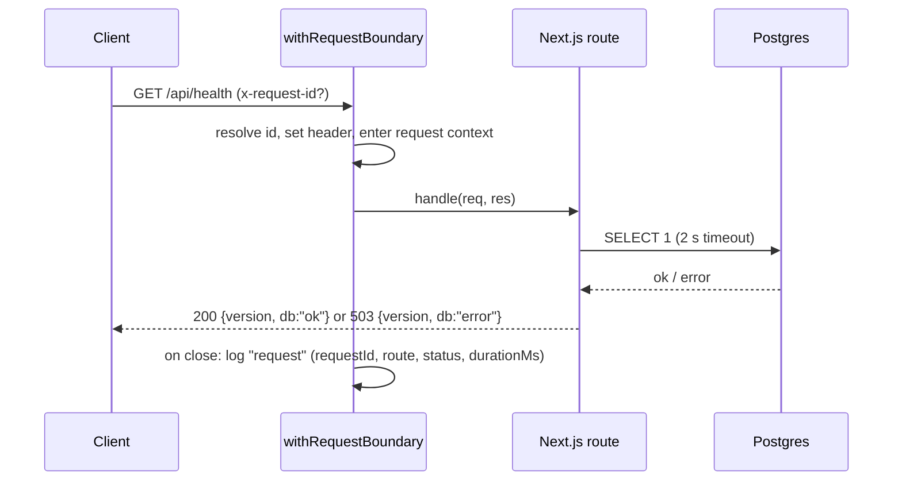

# Scaffolding & environment

## What it does

The runnable baseline every other epic builds on (E00/US-1 to US-5): a Next.js 15 web process behind a small custom Node server, a pg-boss worker, Postgres via Drizzle with SQL migrations, a logging baseline with one correlation id per request, `GET /api/health`, the test harness (Vitest unit + integration, Playwright e2e) and CI, a Docker image with `web` and `worker` roles, the Claude client seam with `FakeClaude`, and the constants of cowriter's 31-dimension style framework.

## How it works

Three entrypoints share one bootstrap, `startProcess(role)` in `src/server/startup.ts`: load `.env*` files the way Next.js does (`loadEnv()` → `@next/env`; variables already in the process win), validate them with Zod (`getEnv()`; invalid → `env.invalid` with variable *names* only, exit 1), install the root logger, write a `startup` line. `onShutdown()` handles SIGTERM/SIGINT for all of them.

- **web** (`src/server/main.ts`): `http.createServer(withRequestBoundary(nextHandler))`. The boundary (`src/server/http.ts`) resolves the request id (reuse a well-formed `x-request-id`, 1–64 of `[A-Za-z0-9_-]`, else a UUID), returns it in the response header, copies it into the request headers for Next code, runs the request inside an AsyncLocalStorage context and writes one `request` line on `close`. Unhandled errors become `{"error":"Internal server error"}`; errors Next catches itself are logged by `src/instrumentation.ts` → `src/server/request-error.ts`.
- **worker** (`src/worker.ts`): pg-boss on `DATABASE_URL`, schema `pgboss`, no queues yet. Exits 1 if the database is unreachable.
- **migrate** (`src/server/db/migrate.ts`): applies `src/server/db/migrations` (copied to `dist/migrations` by the build).

**Why the shared state lives on `globalThis`:** esbuild bundles the custom server and Next bundles the route handlers, so each loads its own copy of every module. `processSingleton()` (`src/server/singleton.ts`) keys the request context, the root logger and the DB pool on `globalThis` so both copies share them. Without it, route-handler logs lose the request id.

**Build:** `npm run build` = `next build` + `scripts/build-server.mjs` (esbuild bundles `dist/main.js`, `dist/worker.js`, `dist/migrate.js`, dependencies external, migrations copied). No `output: "standalone"` (it doesn't trace a custom server). The Next config is plain `next.config.mjs` because Next loads it at runtime and the image has no TypeScript. `@next/env` is loaded with `createRequire` because it is a CommonJS bundle that Node's ESM loader and Next's bundler import differently.

**Claude seam:** `ClaudeClient.stream(params, {feature, fixture?}, onText?)`. `getClaude()` returns `FakeClaude` unless `AI_CLIENT=anthropic`. FakeClaude reads `tests/fixtures/claude/<feature>/<key>.json` (key = `fixture` or a hash of the params) and throws `MissingFixtureError` — it never touches the network. Default model `claude-opus-5-5`. No feature uses it yet (E08).

## Files

| Path | Role |
|------|------|
| `src/server/main.ts` | Web entrypoint: custom server around Next.js |
| `src/server/http.ts` | Request boundary: request id, request log line, generic 500 |
| `src/server/context.ts` | Request context (AsyncLocalStorage) and `resolveRequestId` |
| `src/server/startup.ts` | `startProcess(role)`, `onShutdown()` |
| `src/server/env.ts` | `loadEnv()`, Zod schema, `getEnv()`, `parseEnv()` |
| `src/server/log.ts` | `log(name)`, root logger, `loggerOptionsFrom()`, redaction |
| `src/server/singleton.ts` | `processSingleton()` shared across bundles |
| `src/instrumentation.ts`, `src/server/request-error.ts` | Log errors Next.js catches (`request.error`) |
| `src/app/api/health/route.ts`, `src/server/db/health.ts` | Health endpoint and DB check |
| `src/server/db/client.ts` | pg Pool + Drizzle (`getPool`, `getDb`, `closeDb`), pool `error` listener |
| `src/server/db/migrate.ts`, `src/server/db/migrations/` | Migrations and CLI |
| `src/worker.ts` | Worker entrypoint |
| `src/server/ai/client.ts` | Claude seam, `FakeClaude`, `DEFAULT_MODEL` |
| `src/shared/framework.ts` | Tags, 31 dimensions, `LANGUAGE_SENSITIVE`, `SCENE_LEVEL` |
| `src/shared/version.ts` | `appVersion()` |
| `scripts/build-server.mjs` | esbuild bundle for server, worker, migrate |
| `docker-compose.yml`, `docker/postgres-init/` | Local Postgres (+ `storyforge_test`) |
| `Dockerfile`, `.dockerignore` | Image: deps / prod-deps / build / runtime stages |
| `.github/workflows/ci.yml` | CI: audit, lint, typecheck, tests, build, e2e, image build |
| `tests/helpers.ts`, `tests/process.ts` | `captureLogs()`, `testDatabaseUrl()`, `spawnTs()` |

## Configuration

| Variable | Default | Notes |
|----------|---------|-------|
| `NODE_ENV` | `development` | `development` = coloured logs + Next dev; `production` = JSON logs |
| `PORT` | `3000` | web role |
| `DATABASE_URL` | — (required) | `postgres://…`; invalid → `env.invalid`, exit 1 |
| `DATABASE_URL_TEST` | — | integration and e2e tests (`storyforge_test`) |
| `LOG_LEVEL` | `info` | `trace` … `silent` |
| `LOG_FILE` | empty | path of an extra JSON log file (`.env.example`: `logs/app.log`); empty in the image |
| `AI_CLIENT` | `fake` | `anthropic` calls the API |
| `ANTHROPIC_API_KEY` | — | required when `AI_CLIENT=anthropic`; never logged |
| `APP_VERSION` | package.json version | override for release tags |
| `ROLE` | `web` | image only: `web` or `worker` |
| `POSTGRES_USER`, `POSTGRES_PASSWORD` | — | docker compose only (dev credentials; keep in step with `DATABASE_URL`) |

`.env*` files load as in Next.js (`.env`, `.env.local`, `.env.<mode>`…); variables already set in the process win. Only `.env.example` is committed; the image contains no `.env`.

## Logs & debugging

- **Happy path:** `startup` (role, version, env, logLevel, ai) → `server.listening` / `worker.ready` → one `request` per request (`requestId, method, route, status, durationMs`; static assets at debug) → `server.stop` / `worker.stop` on SIGTERM.
- **Trouble:**
  - `env.invalid` (fatal): lists bad variable names; the process exits 1.
  - `health.db.failed` (warn, `reason: error|timeout`): Postgres down or slow.
  - `db.pool.error` (warn): an idle connection was dropped (Postgres restart). Harmless on its own; the next query reconnects.
  - `request.error` (error, with `err`): an unhandled error; the client got a generic 500.
  - `worker.start.failed`: the worker can't reach the database. `worker.queue.error`: a pg-boss runtime error.
  - `ai.fixture.missing`: a test or local run asked FakeClaude for a fixture that doesn't exist.
- **Follow one request:** take `x-request-id` from the response (or send your own) and `grep '"requestId":"<id>"' logs/app.log`. Every line written while handling it, including inside Next route handlers, carries the id.
- **Debug level:** `LOG_LEVEL=debug npm run dev` (static asset requests, `ai.client`).
- **Never logged:** cookies, `authorization`, request bodies, query strings, API keys (redaction in `src/server/log.ts`; covered by tests).
- **Tools:** `http` (curl with `-H 'x-request-id: …'`) for the web role; `console` for worker and migrate. Recipes in `openspec/changes/e00-scaffold/test-plan.md` (after close, under `openspec/changes/archive/`).

## How to run & test

See the quick-start table in [README.md](README.md#quick-start). In short: `docker compose up -d`, `npm ci`, `npm run db:migrate`, `npm run dev`, `npm run worker`. Tests: `npm run test:unit` (no Docker), `npm test` (unit + integration), `npm run build && npm run test:e2e`. Interactive cases T1–T9 are in the test plan.

**Deployment hardening (when a host is chosen):** run the image with `--read-only --tmpfs /tmp --cap-drop=ALL --security-opt=no-new-privileges` (verified in T8), set memory/CPU/PID limits, run `node dist/migrate.js` as a release step before starting new web and worker containers.

## Known gaps / follow-ups

- The DB client reads `process.env.DATABASE_URL` instead of the validated env → E01.
- Object storage (MinIO or another S3-compatible store) → E03; MinIO's community images can't be pinned reliably any more.
- The image is ~1 GB (mostly Next.js's production dependencies); slimming, BuildKit cache mounts and CI caching (Playwright browser, `.next/cache`, Docker layers) are possible later.
- `npm audit` shows 20 advisories in dev-only tooling (ESLint/Vitest glob libraries, drizzle-kit's esbuild); production dependencies have none (`postcss` overridden to 8.5.33).
- Homebrew's Compose is the standalone `docker-compose`; the docs say `docker compose`.
- CI has not run yet (T7): it runs when `epic/e00-scaffold` is pushed.

## References

- Behavior contract: `openspec/specs/service-health/spec.md` (after archive)
- Change: `openspec/changes/e00-scaffold/` (→ `openspec/changes/archive/<date>-e00-scaffold/` after close)
- PRD: PRD.md §11 Environments & deployment, §12 Observability expectations, §13 Testing strategy; ARCHITECTURE.md §2, §3, §8–§10
